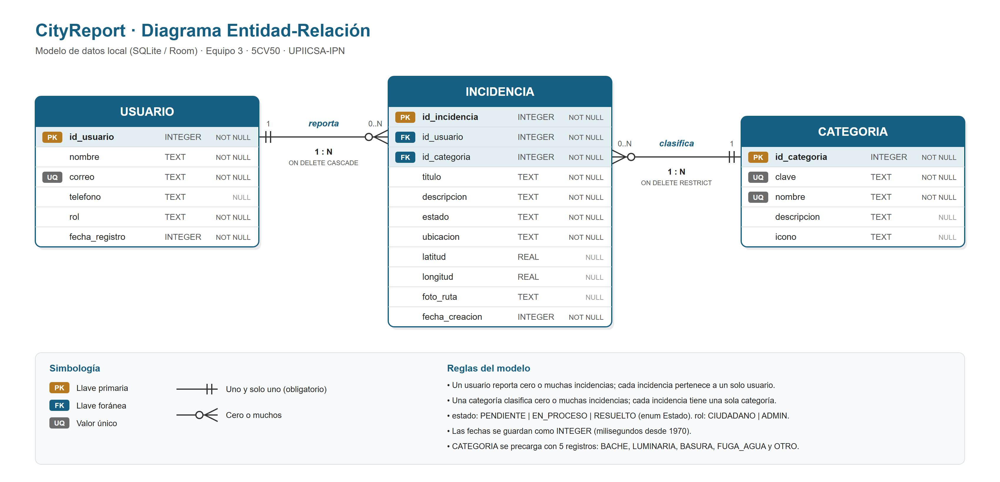

# CityReport

App **Android nativa** de reporte ciudadano. Permite a las personas reportar incidencias urbanas (baches, luminarias, fallas de servicios), consultar una agenda comunitaria y acceder a servicios locales.

Proyecto Integrador de la materia **Programación de Dispositivos Móviles** - LCI 2022, UPIICSA · IPN. Docente: Dr. Francisco Javier Bueno Vásquez.

---

## Equipo y roles

| Integrante                      | Rol | Responsabilidad principal |
|---------------------------------|---|---|
| AVILES SALAZAR BRAULIO EMILIANO | Project Manager (PM) | Backlog, sprints y entregas |
| BALDERAS ROCHA JOSE ANTONIO     | Analista / Product Owner | Historias de usuario y requerimientos |
| MARIN SALDIVAR GAEL ALEJANDRO   | Arquitecto de Software | Estructura técnica y modelo de datos |
| GONZALEZ CAMPOS LUIS ALBERTO    | Desarrollador Android | Código, componentes y lógica |
| RUIZ CRUZ ESTEPHANIE            | Diseñador UI/UX + QA | Interfaz, flujos y pruebas |

---

## Estructura del proyecto (MVP)

La app sigue el patrón **Modelo-Vista-Presentador**: cada pantalla tiene un contrato con dos
interfaces (`View` y `Presenter`); el Fragment implementa la vista y el Presenter tiene la lógica.

```
app/src/main/java/com/equipo3/hellocityreport/
├─ model/            # Modelo: Incidencia, repositorio y proveedor de ubicación (Fused Location Provider)
├─ contract/         # Contratos MVP: interfaces View y Presenter de cada pantalla
├─ presenter/        # Lógica de cada pantalla (Kotlin puro, sin código de Android)
├─ view/             # Vista: Fragments (incluye cámara con CameraX y foto completa), adapter,
│                    #   mapa estático, carga de fotos y notificaciones (NotificationCompat)
├─ MainActivity.kt   # Top App Bar + BottomNavigationView + permiso de notificaciones
└─ CityReportApp.kt  # Colores dinámicos, MapLibre y canal de notificaciones

app/src/test/java/com/equipo3/hellocityreport/presenter/   # Pruebas unitarias de los Presenters
```

Secciones de la barra inferior: **Inicio** (lista y detalle), **Reportar** (formulario) y **Resumen** (conteos por estado y categoría).

Al reportar se toma una foto con **CameraX**, se obtienen las coordenadas con **Fused Location Provider**
(y la dirección con Geocoder) y se muestra un mapa estático con **MapLibre** y los mapas gratuitos de
**OpenFreeMap** (no requieren clave de API). Al guardar llega una notificación con la foto; al tocarla se
abre el detalle. Entre la lista y el detalle, y entre el detalle y la foto completa, hay transiciones de
elementos compartidos.

---

## Modelo de datos (diagrama ER)

Para guardar los datos en el teléfono con **Room** se diseñaron tres tablas: **Usuario**, **Categoría**
e **Incidencia**. Un usuario reporta muchas incidencias y una categoría clasifica muchas incidencias (1 : N).
Las preferencias del usuario (tema y notificaciones) se guardarán aparte con **DataStore**.



Diccionario de datos, decisiones de diseño y script SQL: [docs/diagrama-er](docs/diagrama-er/README.md).

---

## Cómo correr el proyecto

1. Clona el repositorio:
   ```bash
   git clone https://github.com/T3-Programacion-Dispositivos-Moviles/HelloCityReport.git
   ```
2. Ábrelo en **Android Studio** (última versión estable).
3. Espera el **Gradle Sync**.
4. Selecciona un emulador (AVD, API 30+) o un dispositivo físico con **depuración USB** activada.
5. Pulsa **Run**.
6. Para correr las pruebas unitarias de los Presenters: `./gradlew test`.

---
