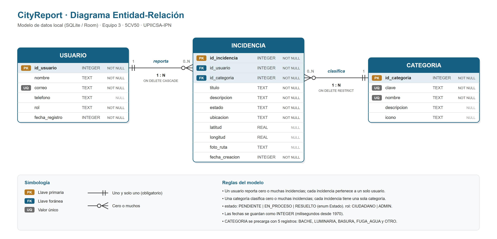
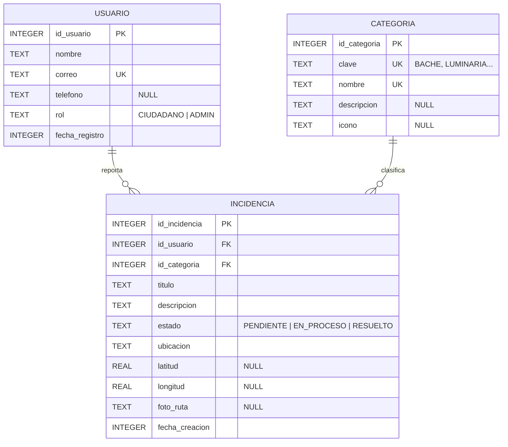

# Diagrama Entidad-Relación de CityReport

Modelo de datos local que usará la app con Room (SQLite) en la Práctica 1 de la UT IV.
Se preparó para la sesión **S11 Flipped: Room + DataStore**.

Versiones del diagrama:

- [diagrama_er_cityreport.png](diagrama_er_cityreport.png): imagen para el reporte y la presentación.
- [diagrama_er_cityreport.svg](diagrama_er_cityreport.svg): versión vectorial; se puede ampliar sin perder calidad.
- [esquema.sql](esquema.sql): tablas en SQL (SQLite), con sus llaves y restricciones.
- El diagrama en Mermaid de abajo, que GitHub dibuja directamente.

## Relaciones

| Relación | Cardinalidad | Llave foránea | Al borrar el registro padre |
|---|---|---|---|
| USUARIO **reporta** INCIDENCIA | 1 : N (un usuario tiene 0 o muchas incidencias; cada incidencia es de un solo usuario) | `incidencia.id_usuario` → `usuario.id_usuario` | `CASCADE`: se borran sus incidencias |
| CATEGORIA **clasifica** INCIDENCIA | 1 : N (una categoría tiene 0 o muchas incidencias; cada incidencia tiene una sola categoría) | `incidencia.id_categoria` → `categoria.id_categoria` | `RESTRICT`: no se puede borrar una categoría en uso |

## Diccionario de datos

### USUARIO

| Campo | Tipo | Nulo | Descripción |
|---|---|---|---|
| id_usuario | INTEGER | No | Llave primaria autoincremental. |
| nombre | TEXT | No | Nombre de la persona que reporta. |
| correo | TEXT | No | Correo electrónico, único. Se usará para iniciar sesión (Firebase Auth en la UT IV). |
| telefono | TEXT | Sí | Teléfono de contacto opcional. |
| rol | TEXT | No | `CIUDADANO` (reporta) o `ADMIN` (cambia el estado de las incidencias). |
| fecha_registro | INTEGER | No | Fecha de alta en milisegundos desde 1970. |

### CATEGORIA

| Campo | Tipo | Nulo | Descripción |
|---|---|---|---|
| id_categoria | INTEGER | No | Llave primaria. |
| clave | TEXT | No | Valor del enum `Categoria` de la app (`BACHE`, `LUMINARIA`, `BASURA`, `FUGA_AGUA`, `OTRO`), único. |
| nombre | TEXT | No | Texto que se muestra en pantalla (por ejemplo, "Fuga de agua"), único. |
| descripcion | TEXT | Sí | Explicación breve de qué entra en la categoría. |
| icono | TEXT | Sí | Nombre del recurso drawable del icono. |

### INCIDENCIA

| Campo | Tipo | Nulo | Descripción |
|---|---|---|---|
| id_incidencia | INTEGER | No | Llave primaria autoincremental. |
| id_usuario | INTEGER | No | Llave foránea al usuario que reportó. |
| id_categoria | INTEGER | No | Llave foránea a la categoría. |
| titulo | TEXT | No | Título corto del problema. |
| descripcion | TEXT | No | Detalle del problema. |
| estado | TEXT | No | `PENDIENTE`, `EN_PROCESO` o `RESUELTO` (enum `Estado`); al crearla es `PENDIENTE`. |
| ubicacion | TEXT | No | Dirección legible (Geocoder o escrita a mano). |
| latitud | REAL | Sí | Latitud del Fused Location Provider; nula si no hubo GPS. |
| longitud | REAL | Sí | Longitud del Fused Location Provider; nula si no hubo GPS. |
| foto_ruta | TEXT | Sí | Ruta del archivo que guardó CameraX en `filesDir/fotos`. |
| fecha_creacion | INTEGER | No | Fecha del reporte en milisegundos desde 1970. |

## Decisiones de diseño

- **Categoría como tabla.** En el código actual `Categoria` es un enum. Como tabla se pueden agregar categorías nuevas sin publicar otra versión de la app, y cada una puede tener descripción e icono. La columna `clave` conserva el nombre del enum para relacionarlos.
- **Estado como columna.** `Estado` tiene solo tres valores fijos que no cambian, así que se guarda como texto en la incidencia. Room lo convierte con un `TypeConverter`.
- **Fechas como número.** Hoy la fecha es un `String` ("18/09/2026"). Guardarla como milisegundos permite ordenar y filtrar por fecha directamente en las consultas.
- **Coordenadas y foto opcionales.** El formulario permite escribir la dirección a mano si no hay GPS, y los datos de ejemplo no tienen foto, por eso esos campos admiten nulos.
- **La foto no va dentro de la base.** Solo se guarda la ruta; la imagen se queda como archivo. Así la base es ligera y después se puede subir la foto a Firebase Storage.
- **Índices en las llaves foráneas.** Room recomienda indexar `id_usuario` e `id_categoria` para que las consultas por usuario o por categoría sean rápidas.
- **Preferencias fuera de la base.** El tema claro u oscuro y el permiso de notificaciones no son tablas: se guardarán con DataStore, porque son pocos valores sueltos de configuración.
