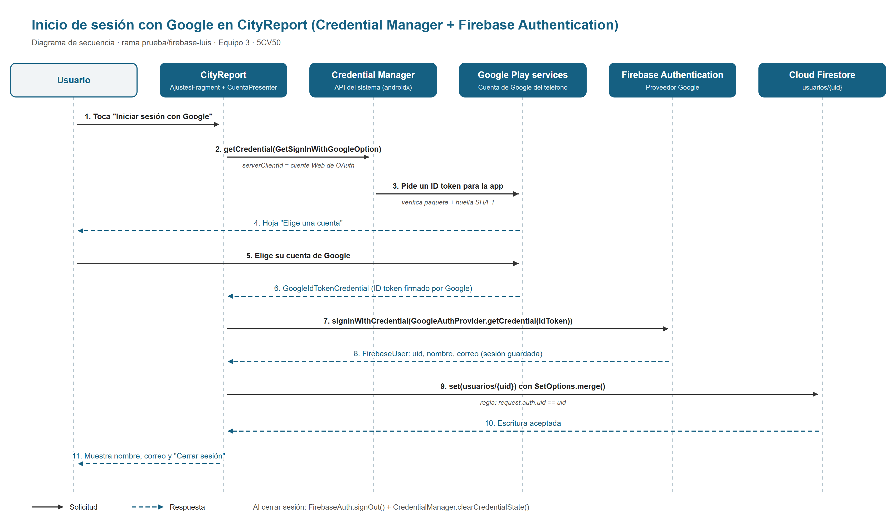

# Firebase en CityReport (rama de prueba)

Guía para que cada integrante configure Firebase en **su propia rama de prueba** y pruebe el inicio de
sesión con Google. Se preparó para la sesión **S13 Flipped: Firebase + Multimedia**.

El código ya está en la rama `prueba/firebase-luis`: Firebase Authentication con Google Sign-In
(Credential Manager), el perfil del usuario en Cloud Firestore y las dependencias de Cloud Storage.
Lo único que cambia entre integrantes es el archivo `app/google-services.json`, que **no se sube al
repositorio** (está en `.gitignore`) porque cada quien usa su propio proyecto de Firebase.



## 1. Crear tu rama

```bash
git fetch
git switch -c prueba/firebase-<tu-nombre> origin/prueba/firebase-luis
```

## 2. Consola de Firebase (console.firebase.google.com)

1. Crea un proyecto (por ejemplo `cityreport-<tu-nombre>`). Google Analytics no es necesario.
2. Agrega una app **Android** con el paquete `com.equipo3.hellocityreport` y la huella **SHA-1** de tu
   llave de depuración. Para obtenerla (en Windows, con el JDK de Android Studio):
   ```bash
   keytool -J-Duser.language=en -list -v -keystore %USERPROFILE%\.android\debug.keystore -alias androiddebugkey -storepass android
   ```
   `-J-Duser.language=en` evita un error de `keytool` cuando Windows está en español.
3. **Authentication → Método de inicio de sesión → Google**: actívalo y elige el correo de soporte.
4. **Firestore Database → Crear base de datos**: elige ubicación y **modo de producción**. En la pestaña
   **Reglas** reemplaza todo por:
   ```
   rules_version = '2';
   service cloud.firestore {
     match /databases/{database}/documents {
       match /usuarios/{uid} {
         allow read, write: if request.auth != null && request.auth.uid == uid;
       }
     }
   }
   ```
   y presiona **Publicar**.
5. Descarga `google-services.json` **después** de activar Google (así incluye el cliente Web de OAuth) y
   ponlo en `app/google-services.json`.

**Cloud Storage** no se activa por ahora: desde febrero de 2026 Firebase pide el plan Blaze (de pago por
uso, con tarjeta registrada) para crear el bucket. Las dependencias ya están listas para cuando se use.

## 3. Probar

1. Compila y ejecuta la app. Si el emulador no tiene una cuenta de Google, la hoja de cuentas ofrece
   "Add another account".
2. Abre **Ajustes** (engrane de la barra superior) → **Iniciar sesión con Google** y elige tu cuenta.
3. En Logcat, filtra por `CuentaFirebase`: debe aparecer `Perfil guardado en Firestore`. En la consola
   verás el documento en la colección `usuarios`.

## Problemas comunes

| Síntoma | Causa | Solución |
|---|---|---|
| `File google-services.json is missing` al compilar | Falta el archivo | Descárgalo de la consola y ponlo en `app/` |
| La hoja de cuentas no abre o regresa error | Falta la SHA-1 o Google no está activado | Agrega la SHA-1, activa Google y vuelve a descargar el JSON |
| `Unresolved reference: default_web_client_id` | El JSON se descargó antes de activar Google | Vuelve a descargarlo |
| `PERMISSION_DENIED` en Logcat | Reglas de Firestore incompletas o sin publicar | Pega las reglas completas del paso 4 y publica |
| `binary version of its metadata is 2.4.0, expected 2.2.0` | Firebase BoM 35 usa Kotlin 2.4 y AGP 9.3 trae Kotlin 2.2 | Ya está resuelto en la rama: se declara Kotlin 2.4.21 en `build.gradle.kts` |
